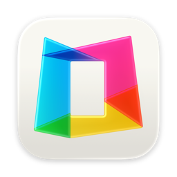
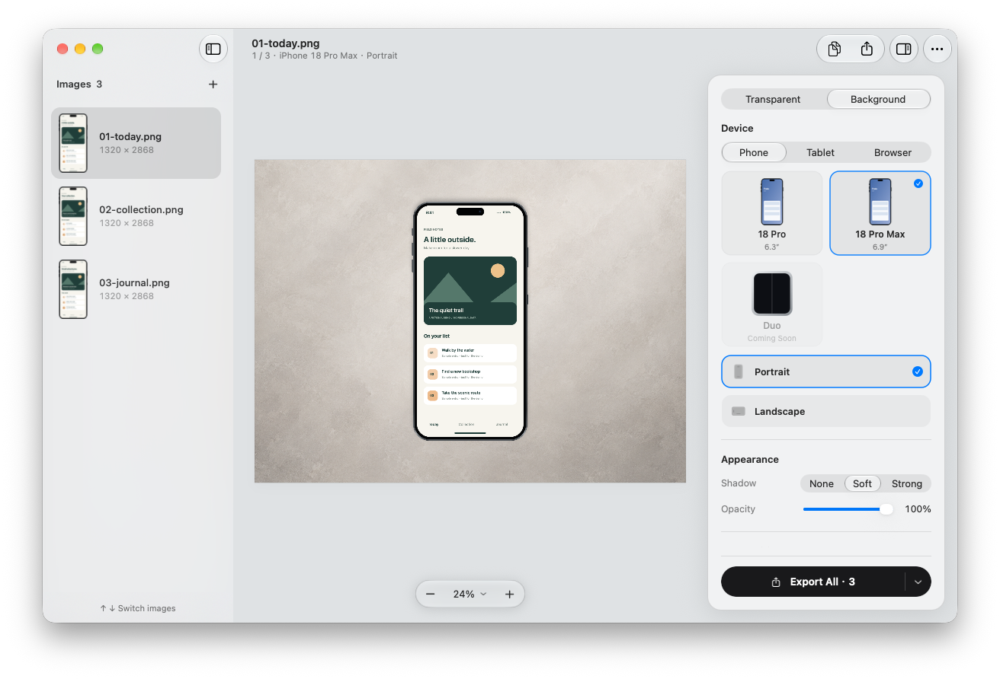
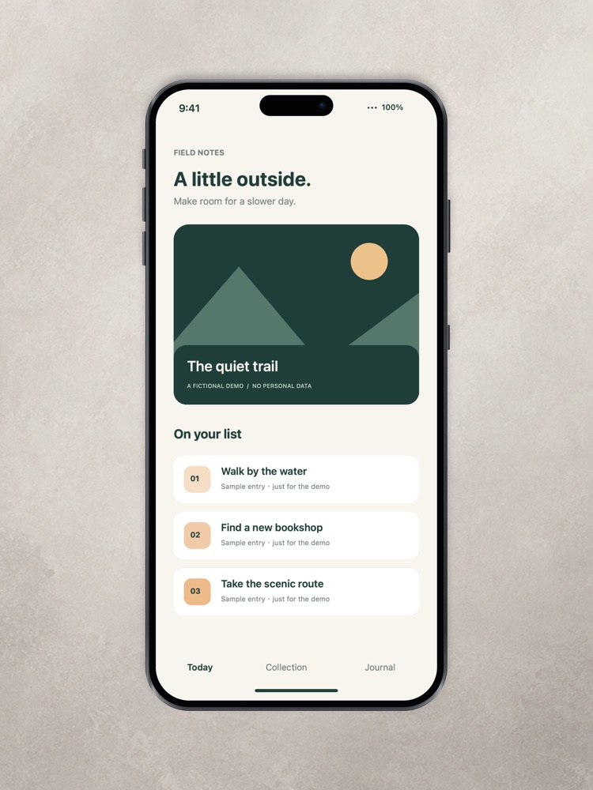
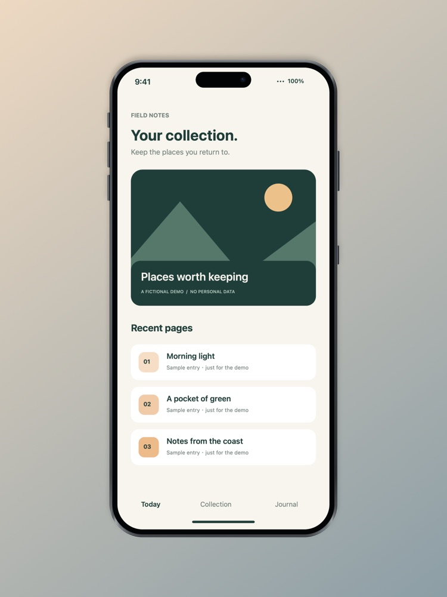
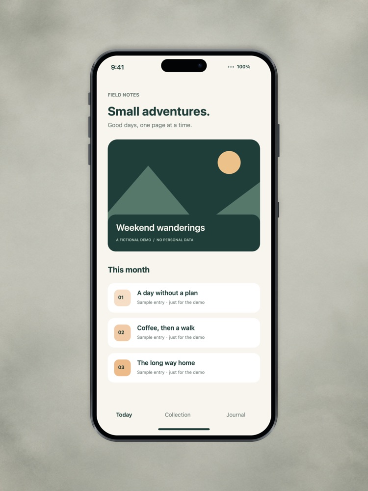
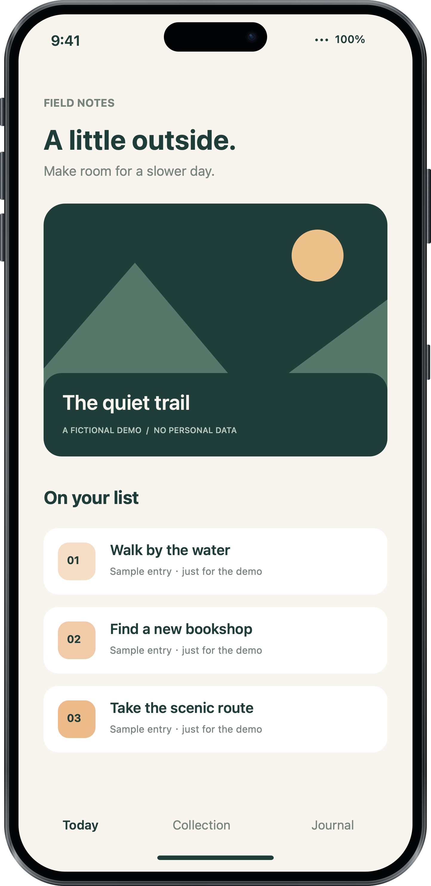

<div align="center">

**English** · [简体中文](README.zh-CN.md)



# Fralo

**Batch-frame screenshots into device mockups on your Mac. Import once, export once.**

[](https://github.com/SoaringLabs/Fralo/releases/latest)
[](https://github.com/SoaringLabs/Fralo/actions/workflows/ci.yml)
[](#requirements)
[](Package.swift)
[](LICENSE)

[**Download**](https://github.com/SoaringLabs/Fralo/releases/latest) ·
[Changelog](CHANGELOG.md) ·
[Install guide](INSTALL.md) ·
[Contributing](CONTRIBUTING.md)

</div>

<picture>
  <source media="(prefers-color-scheme: dark)" srcset="docs/assets/workbench-en-dark.png">
  
</picture>

Fralo is a native macOS app and command-line tool that puts your screenshots inside
phone, tablet, and browser frames. Drop in a batch of PNG or JPEG screenshots, choose a
device and a look once, check the preview, and export the whole batch as transparent PNGs
or finished images on a background.

Everything runs locally: no account, no upload, no analytics. The App and the CLI are
built on the same Core Graphics rendering core.

## Features

- **Batch first.** Drag in files, a folder, or paste from the clipboard. Duplicates are
  skipped, and every image in the batch shares one set of settings.
- **Phone, tablet, and browser shells.** iPhone 18 Pro and Pro Max in portrait or landscape,
  a tablet, and Safari or Chrome windows in 16:10, 16:9, or 4:3 with light or dark chrome.
- **Transparent or on a background.** Export a cut-out device with alpha, or place it on a
  1:1, 4:3, 16:9, 3:4, or 9:16 canvas over a solid color, a gradient, a preset texture, or
  your own image.
- **Direct composition.** Set device size, position, shadow, and opacity. Drag the device or
  pan the background right in the preview, and nudge by 1 px with ⌥ and the arrow keys.
- **Pixel-faithful output.** Phone frames are sized so native-resolution screenshots are
  placed 1:1, without resampling. Rounded corners and the Dynamic Island are masked
  automatically.
- **PNG or JPEG.** Lossless PNG, smaller PNG presets, or JPEG with quality and fill color.
- **Safe exports.** Existing files are skipped unless you choose to overwrite, originals are
  never touched, exports can be canceled, and one failed image does not stop the batch.
- **A real Mac app.** Native sidebar, toolbar, menus, keyboard shortcuts, undo and redo,
  English, Simplified Chinese, Traditional Chinese, and Japanese, light and dark appearance,
  and support for Reduce Motion, Reduce Transparency, and Increase Contrast.
- **Scriptable.** A bundled `fralo` CLI renders batches without opening the App.
- **Signed updates.** In-app updates through [Sparkle](https://sparkle-project.org), with
  Ed25519-verified archives. Fralo checks GitHub once a day, never installs silently, and can
  be set to check only on request.

## Showcase

| Warm preset | Gradient | Sage preset | Transparent PNG |
| :---: | :---: | :---: | :---: |
|  |  |  |  |

All examples use the fictional *Field Notes* screens in [`examples/`](examples), generated by
[`scripts/generate-demo.swift`](scripts/generate-demo.swift). They contain no personal data.

## Installation

### Download

1. Download `Fralo-<version>-arm64.dmg` and `SHA256SUMS.txt` from the
   [latest release](https://github.com/SoaringLabs/Fralo/releases/latest).
2. Verify the download (optional, recommended):

   ```bash
   shasum -a 256 -c SHA256SUMS.txt
   ```

3. Open the DMG and drag **Fralo** to **Applications**.

Release DMGs are signed with Developer ID and notarized by Apple. See [INSTALL.md](INSTALL.md)
for first launch, updating, and uninstalling.

### Updating

Fralo 0.1.1 and later update in place: choose **Fralo → Check for Updates…**.
Installing waits for any running export to finish. Fralo 0.1.0 has no updater; install the
latest DMG once.

### Requirements

| | |
| --- | --- |
| macOS | 14 Sonoma or later (runtime-verified on macOS 27; older versions are build targets only) |
| Hardware | Apple silicon. Intel builds are not published. |
| Interface languages | English, Simplified Chinese, Traditional Chinese, Japanese |

## Usage

Choose **Fralo → Settings… → Appearance → Language** to change the interface language
immediately. The default follows your macOS preferred languages; unsupported languages
fall back to English.

1. **Add screenshots.** Drag PNG or JPEG files onto the window, press ⌘O to choose files,
   ⇧⌘O to import a folder (top level only), or ⌘V to paste.
2. **Pick a device.** Choose phone, tablet, or browser, then the model and orientation.
   Screenshots must match the orientation you pick.
3. **Choose a look.** Keep the output transparent, or switch to a background and set the
   canvas, background, size, position, and shadow.
4. **Check it.** Step through the batch with ⌘[ and ⌘], fit to window with ⌘0, or inspect
   actual pixels with ⌘1.
5. **Export.** ⇧⌘E exports the whole batch to a folder, ⌘E exports the current image, and
   ⌘C copies the current result at full resolution.

<details>
<summary><b>Keyboard shortcuts</b></summary>

| Action | Shortcut |
| --- | --- |
| Add images · Import folder | ⌘O · ⇧⌘O |
| Paste images · Copy current result | ⌘V · ⌘C |
| Export all · Export current image | ⇧⌘E · ⌘E |
| New batch | ⌘N |
| Remove selected image | ⌫ |
| Undo · Redo | ⌘Z · ⇧⌘Z |
| Previous · Next image | ⌘[ · ⌘] |
| Fit to window · Actual pixels | ⌘0 · ⌘1 |
| Zoom in · Zoom out | ⌘+ · ⌘− |
| Nudge device by 1 px | ⌥ + arrow keys |
| Toggle sidebar · Settings panel · Output preview | ⌃⌘S · ⌥⌘I · ⌥⌘P |
| Settings | ⌘, |

</details>

## Command-line interface

The `fralo` CLI ships inside the App and renders transparent phone frames without opening
the App window:

```bash
/Applications/Fralo.app/Contents/MacOS/fralo --help
```

Fralo never edits your `PATH`; link or copy the binary yourself if you want it there.

```bash
# List available device models
fralo models

# Frame every PNG/JPEG in a folder
fralo render ./screenshots --output ./framed

# Pick a model and orientation, and print a JSON report
fralo render one.png two.jpg --output ./framed \
  --model iphone-18-pro-max --orientation portrait --json
```

| Option | Description |
| --- | --- |
| `--output`, `-o <dir>` | Output directory (required) |
| `--input`, `-i <path>` | Additional input; repeatable. Folders are not read recursively. |
| `--model <id>` | Device model, for example `iphone-18-pro-max`. See `fralo models`. |
| `--orientation <value>` | `portrait` or `landscape` |
| `--overwrite` | Replace existing output files. Inputs are always protected. |
| `--json` | Write a JSON result to stdout; progress goes to stderr. |

The CLI renders all six iPhone 16, 17, and 18 Pro and Pro Max frames. Settings resolve as
built-in defaults → settings saved by the App → flags on this run; flags never write back to
the App. Output files are named `<name>-fralo.png`.

<details>
<summary><b>Configuration and exit codes</b></summary>

Settings live in `~/Library/Application Support/Fralo/settings.json`. Set
`FRALO_SETTINGS_PATH` to use a separate file for scripts and tests.

| Exit code | Meaning |
| --- | --- |
| `0` | Finished (some files may have been skipped) |
| `1` | One or more images failed |
| `2` | Invalid arguments or startup error |
| `130` | Canceled with Ctrl-C; finished files are kept |

</details>

## Privacy

Screenshots are processed on your Mac and never leave it. The only network request is the
update check to GitHub, which sends no screenshots and no system profile. You can turn
automatic checks off from the Fralo menu.

## Building from source

Requires macOS with Xcode 26.3 or later and Python 3.10 or later. Packaging the App icon
needs Xcode 27's `actool`; the core library and CLI do not.

```bash
git clone https://github.com/SoaringLabs/Fralo.git
cd Fralo

# Test and build
swift test --build-system native
swift build --build-system native -c release

# Package Fralo.app and a DMG into dist/
python3 -m venv .venv
.venv/bin/python -m pip install -r scripts/requirements-dmg.txt
.venv/bin/python scripts/package.py --configuration release --dmg
open dist/Fralo.app
```

Local builds are ad-hoc signed and not notarized. The maintainer signing and release process
is described in [docs/signing.md](docs/signing.md) and [docs/updates.md](docs/updates.md).

To check for dependency and toolchain updates on demand (Python 3.10+, no extra packages):

```bash
python3 -B scripts/check_updates.py
python3 -B scripts/check_updates.py --json
```

The read-only check compares locked Swift packages, pinned DMG tools and GitHub Actions,
local Swift/Xcode/macOS SDK versions, and Xcode versions declared in CI with upstream
stable releases. It links to upstream release information and reports query failures explicitly.
Swift language mode, the package tools requirement and the minimum macOS target are shown
as context. Apple Swift and upstream Swift versions may differ; a version difference alone
does not establish compatibility or require migration. No files, dependencies, installations,
or schedules are changed. Exit code `0` means all comparisons completed (updates may exist);
`2` means at least one check failed or needs review. `--repo` selects another checkout;
`--timeout` sets each HTTP request's timeout (default 15 seconds). GitHub queries are public;
optionally set `GITHUB_TOKEN` or `GH_TOKEN` if rate-limited. Offline checks for the script:
`python3 -B scripts/test_check_updates.py`.

<details>
<summary><b>Project layout</b></summary>

| Path | Contents |
| --- | --- |
| [`Sources/FraloCore`](Sources/FraloCore) | Rendering, device geometry, settings, and batch export shared by the App and CLI |
| [`Sources/FraloApp`](Sources/FraloApp) | The AppKit workbench, inspector, and Sparkle updater |
| [`Sources/FraloDesignSystem`](Sources/FraloDesignSystem) | Shared native controls and surfaces |
| [`Sources/FraloCLI`](Sources/FraloCLI) | The `fralo` command-line tool |
| [`Tests`](Tests) | Core, App, and design-system tests |
| [`scripts`](scripts) | Packaging, verification, demo generation, and preview launchers |

</details>

## Scope and limitations

- Device frames are original, parametric drawings. They are not Apple's official frames or
  photo-accurate templates, and no official Apple device artwork is included.
- Screenshots are never stretched. The App always shows the whole screenshot inside the
  device screen. The CLI fills the screen and allows up to 3% cropping; images whose aspect
  ratio differs more than that are reported as failed.
- Fralo does not edit screenshot content, correct orientation, or add captions.

## Contributing

Bug reports and pull requests are welcome. Please read [CONTRIBUTING.md](CONTRIBUTING.md)
first, and use generated samples instead of personal screenshots in issues. CI runs the core
tests, release build, CLI integration checks, and public-source checks on every pull request.

## License

Fralo is released under the [MIT License](LICENSE). It is developed by
[Soaring Labs](https://github.com/SoaringLabs) and maintained by
[Ethan (@Peek-A-Booo)](https://github.com/Peek-A-Booo); see [AUTHORS.md](AUTHORS.md).

In-app updates use [Sparkle](https://github.com/sparkle-project/Sparkle), whose license is
bundled with the App. iPhone and Safari are trademarks of Apple Inc., and Chrome is a
trademark of Google LLC. Fralo is not affiliated with or endorsed by either company.
