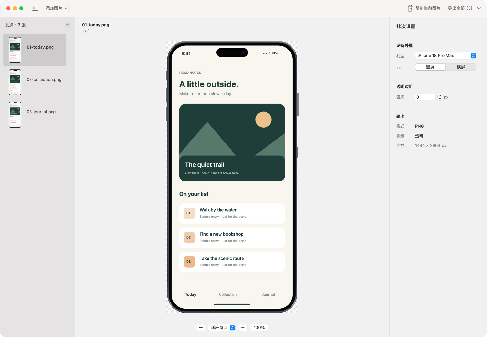
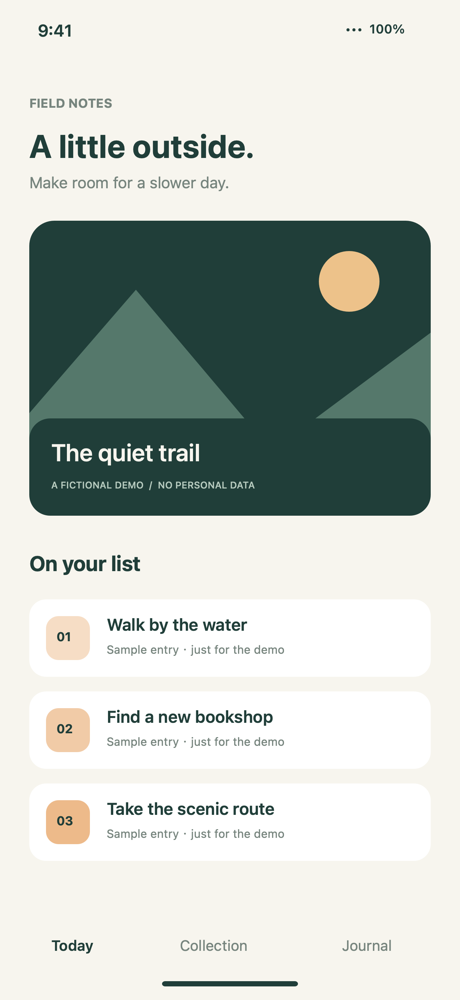
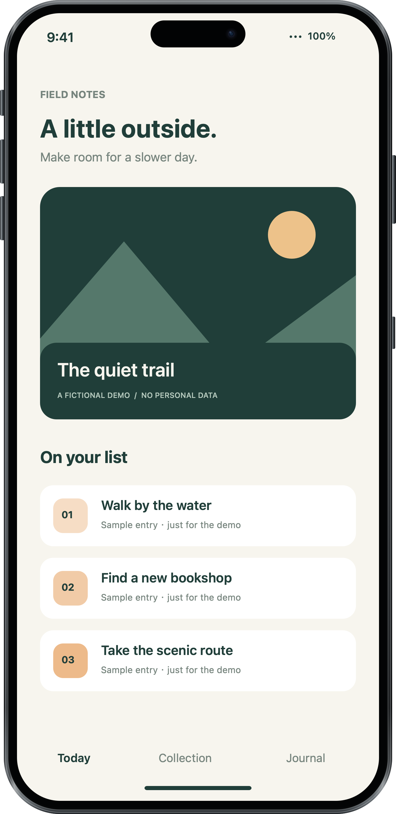
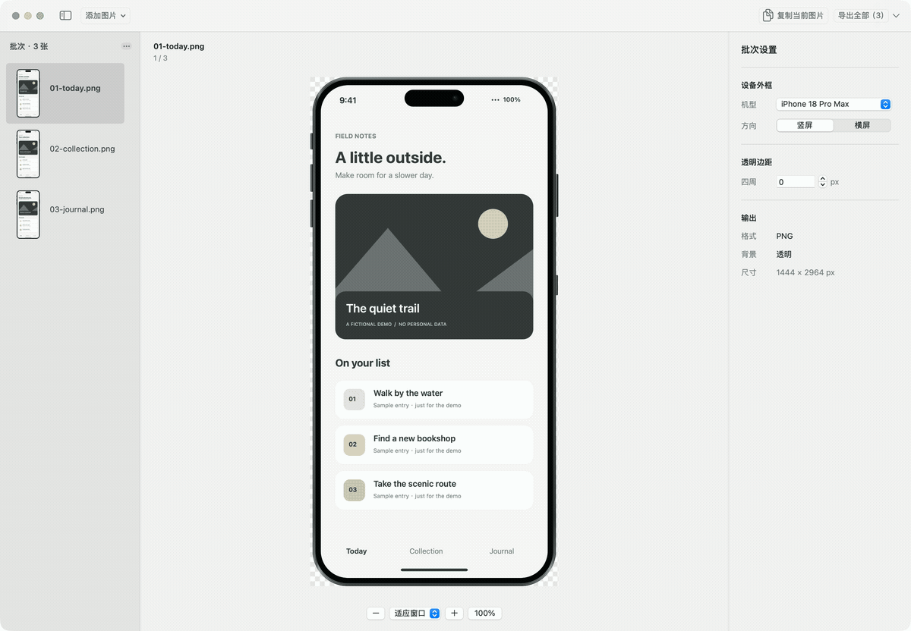

# Fralo

**本地批量截图套框，一次导入，一次导出。**

Fralo 是原生 macOS 截图套框工具。拖入一批 PNG / JPEG，统一选择 iPhone 外框、
横竖屏和透明边距，检查预览后导出透明 PNG，或复制当前成品给其他工具。

App 和 CLI 使用同一套 Core Graphics 渲染核心。无需联网、账号或上传截图。

| 原始截图 | Fralo 输出（透明 PNG） |
| --- | --- |
|  |  |

演示由实际操作关键帧组成，展示批次切换和透明边距调整；时间经过编排，不代表处理耗时。

以上界面和演示使用虚构的 Field Notes 示例，不含个人资料。
[示例图片与复现方式](examples/README.md)。

## 安装

当前版本为 0.1.0，提供 Apple Silicon（arm64）安装包：

- [下载 Fralo-0.1.0-arm64.dmg](https://github.com/SoaringLabs/Fralo/releases/download/v0.1.0/Fralo-0.1.0-arm64.dmg)
- [下载 SHA256SUMS.txt](https://github.com/SoaringLabs/Fralo/releases/download/v0.1.0/SHA256SUMS.txt)
- [版本说明](https://github.com/SoaringLabs/Fralo/releases/tag/v0.1.0)

安装、首次启动和卸载步骤见 [INSTALL.md](INSTALL.md)。

已验证环境：Apple Silicon / macOS 27.0.1。
编译目标 macOS 14；旧系统和 Intel 尚未完成运行验收。
正式发行 DMG 已使用 Developer ID 签名、通过 Apple 公证并附加公证凭证。
自行从源码构建默认采用 ad-hoc 签名，具体区别见安装说明。

## App 使用

1. 拖入 PNG / JPEG、多选文件、导入文件夹当前层，或按 ⌘V 粘贴截图。
2. 选择机型、竖屏 / 横屏、透明边距。同批次共享设置，下次启动沿用上次设置。
3. 从左侧列表切换图片，适应窗口或放大到 100% 检查。
4. “复制当前图片”复制完整分辨率透明 PNG；“导出全部”一次选择输出目录。
   旁边下拉提供“导出当前图片”。

相同文件自动去重，可追加、移除或清空批次。
已有同名输出默认跳过，覆盖须显式选择；始终保护原始输入。
导出可取消，保留已完成文件；单图失败继续处理，结束后汇总结果并可打开输出目录。

快捷键：⌘O 添加图片，⇧⌘O 导入文件夹，⌘V 粘贴，⌘C 复制当前图，
⇧⌘E 导出全部，⌘E 导出当前图，⌘N 新批次，⌃⌘S 侧边栏，
⌘0 适应窗口，⌘1 实际像素，Delete 移除当前图。

## CLI

安装 App 后，也可直接调用包内 CLI：

    "/Applications/Fralo.app/Contents/MacOS/fralo" --help

源码构建后：

    ./dist/fralo models
    ./dist/fralo render ./screenshots --output ./framed
    ./dist/fralo render one.png two.jpg --output ./framed \
      --model iphone-18-pro-max --orientation portrait --padding 24 --json
    ./dist/fralo settings

CLI 无需打开 App。配置优先级：
内置默认值 → App 已保存设置 → 本次明确参数。
显式参数只覆盖本次任务，不回写 App；输入输出路径每次指定。

设置文件位于 ~/Library/Application Support/Fralo/settings.json。
可用 FRALO_SETTINGS_PATH 指定独立配置文件，适合测试与脚本任务。

默认命名为“原名-fralo.png”，批次内不同来源同名时追加序号。
文件夹只导入当前层 PNG / JPEG，不递归。
--overwrite 显式覆盖已有输出；--json 将结果写到标准输出，进度写到标准错误。

Ctrl-C 取消并保留已完成文件。
退出码：0 完成（可有跳过），1 存在单图失败，2 参数或启动错误，130 取消。
完整参数见 fralo --help。CLI 可自行加入 PATH，项目不会自动修改 PATH。

## 构建与验证

需要 macOS、Swift 工具链和 Python 3。当前完整打包环境为 Xcode 27.0，
图标编译需要完整 Xcode 的 actool。只构建 Core / CLI 不依赖图标编译。

    swift test
    swift build -c release
    python3 scripts/verify_cli.py "$(swift build -c release --show-bin-path)/fralo"
    python3 scripts/check_public_source.py

CLI 检查自动生成测试图片，在临时目录隔离配置与输出，无需本机截图或模拟器。

    python3 -m venv .venv
    .venv/bin/python -m pip install -r scripts/requirements-dmg.txt
    .venv/bin/python scripts/package.py --configuration release --dmg
    open dist/Fralo.app

构建结果位于 dist：Fralo.app、fralo、Fralo-0.1.0-arm64.dmg 和 SHA256SUMS.txt。
DMG 使用固定图标布局与拖拽引导，打开后只显示 Fralo 和 Applications。
App 内置 CLI 和说明文件；DMG 构建依赖不会进入 App。打包需要 Python 3.10 或更新版本。
版本统一定义于 [FraloInfo.swift](Sources/FraloCore/FraloInfo.swift)。
图标源文件为 [Resources/Fralo.icon](Resources/Fralo.icon)，会编译为分层图标及 icns 回退资源。
维护者的正式签名与公证流程见 [docs/signing.md](docs/signing.md)。

GitHub Actions 对 main 分支推送和 Pull Request 执行 Core 测试、构建、CLI 与公开源码检查。
[验证范围与验收步骤](docs/acceptance.md) · [贡献指南](CONTRIBUTING.md)。

## 当前范围

六款机型：iPhone 16 / 17 / 18 Pro、Pro Max，均支持横竖屏。
外框为独立绘制的参数化图形，不是 Apple 官方或照片级精确模板，
不包含 Apple 官方外框 PNG。

输出按源图像素密度与完整设备边界确定，默认零透明边距，包含侧键。
原图等比适配，允许最多 3% 的比例裁切；超过时报告该张失败。
设备圆角与灵动岛会遮住相应区域。用户须提供与所选方向对应的截图。
预览缩放只影响查看倍率，不改变导出尺寸。透明边距范围为 0–2048px。

首版聚焦透明设备素材：不含错误方向纠正、截图内容编辑、
海报背景、其他设备类型或多套命名预设。

## 开发者与许可

由 [Soaring Labs](https://github.com/SoaringLabs) 维护，
当前维护者为 [Ethan / @Peek-A-Booo](https://github.com/Peek-A-Booo)。

原创代码、参数化外框、图标源文件与自生成示例采用 [MIT 许可](LICENSE)。
[开发者信息](AUTHORS.md) · [更新记录](CHANGELOG.md)。

个人验收截图、设计过程和生成的安装包保留在本机，不随源码公开。
