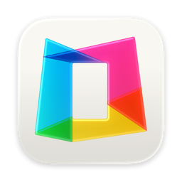
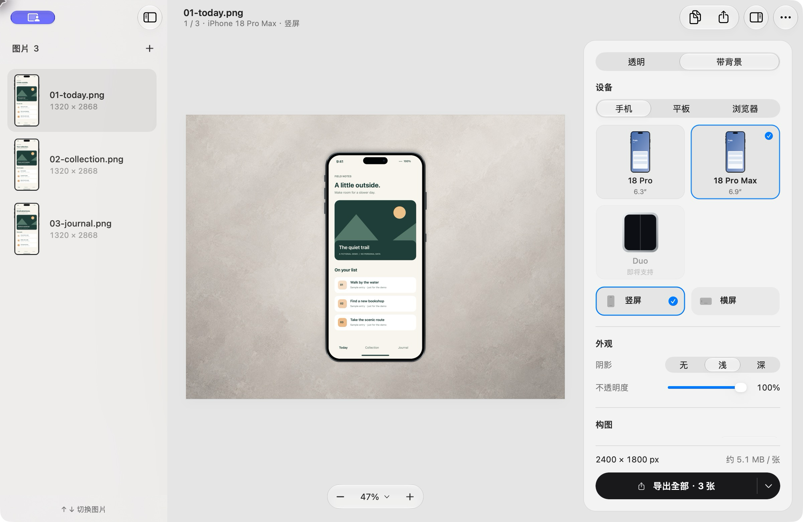
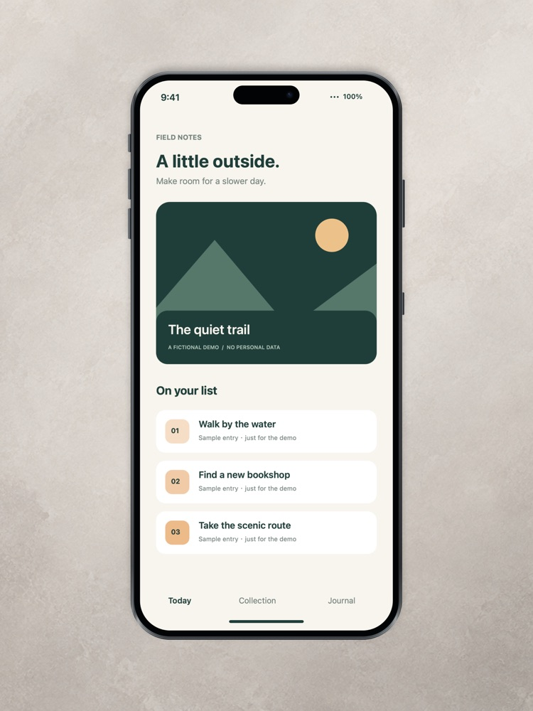
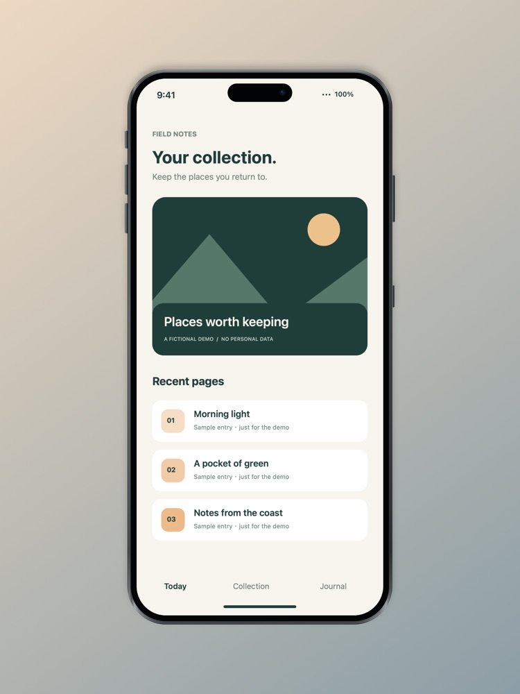
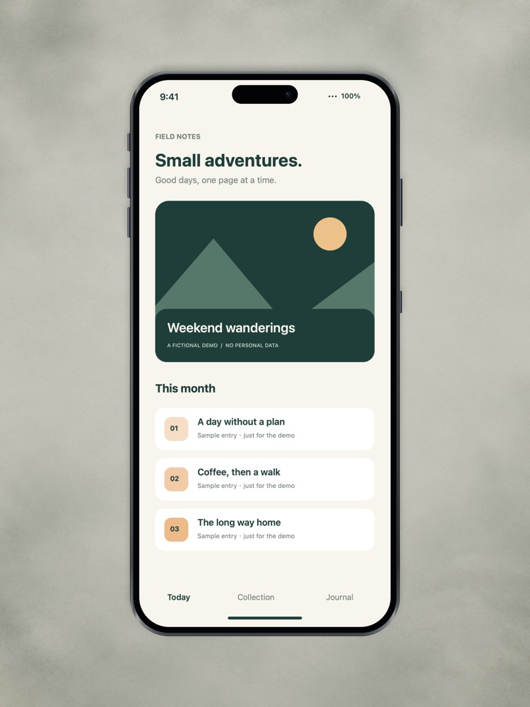
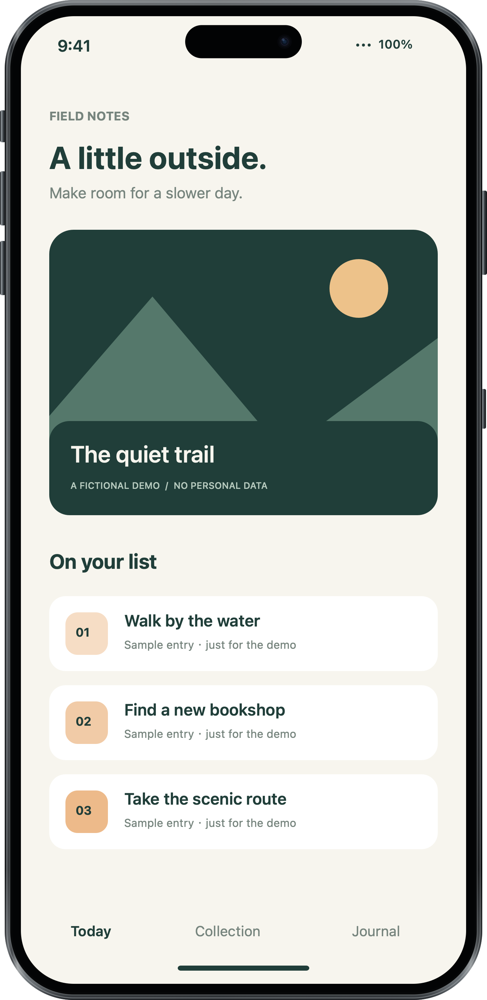
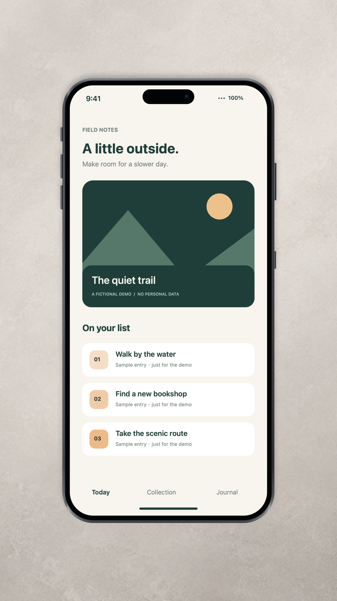

<div align="center">

[English](README.md) · **简体中文**



# Fralo

**Mac 上的批量截图套框工具。一套构图，整批出图。**

[](https://github.com/SoaringLabs/Fralo/releases/latest)
[](https://github.com/SoaringLabs/Fralo/actions/workflows/ci.yml)
[](#系统要求)
[](Package.swift)
[](LICENSE)
[](https://x.com/peekbomb)

[**下载 macOS App**](https://github.com/SoaringLabs/Fralo/releases/latest) ·
[**CLI 快速上手**](#命令行) ·
[**AI Agent**](#用-ai-agent-批量出图) ·
[更新记录](CHANGELOG.md) ·
[安装说明](INSTALL.md) ·
[贡献指南](CONTRIBUTING.md)

</div>

<picture>
  <source media="(prefers-color-scheme: dark)" srcset="docs/assets/workbench-dark.png">
  
</picture>

为 App Store 页面、发布文章或文档准备成组的截图展示图。导入 PNG 或 JPEG 截图，选好手机、平板或浏览器外框，用同一套构图逐张预览，再批量导出透明 PNG 或带背景的成品。

## 功能

| 你想做什么 | Fralo 提供什么 |
| --- | --- |
| 选合适的展示外框 | iPhone 18 Pro、iPhone 18 Pro Max 和平板支持横竖屏。Safari 和 Chrome 外框支持浅色、深色及 16:10、16:9、4:3 窗口比例。 |
| 搭配画布和背景 | 保留透明背景，或将设备放在 1:1、4:3、16:9、3:4、9:16 画布上。背景可选纯色、渐变、预设纹理或自选图片。 |
| 在预览中微调构图 | 直接拖动设备或平移背景，调整大小、阴影和不透明度。按住 ⌥ 再按方向键可按 1 px 微调设备。 |
| 选择输出格式 | 可用无损 PNG、体积更小的 PNG 预设，或可调质量和底色的 JPEG。透明成品使用 PNG。 |
| 把重复工作交给终端 | App 和 `fralo compose` 共用渲染器。可复用 App 保存的构图，也可用独立的 JSON 配置。 |

工作台支持浅色和深色外观、撤销与重做，以及系统的减少动态效果、降低透明度和增强对比度设置。

## 安装

从[最新版本](https://github.com/SoaringLabs/Fralo/releases/latest)下载 `Fralo-<版本>-arm64.dmg`，打开后将 Fralo 拖入「应用程序」文件夹。正式安装包经 Developer ID 签名和 Apple 公证。校验下载、首次启动及卸载步骤见[安装指南](INSTALL.md)。

本文说明当前源码中的功能。各版本的变化见[更新记录](CHANGELOG.md)。

### 系统要求

- **Mac：** Apple 芯片。
- **macOS：** 最低部署目标为 macOS 14 Sonoma，已在 macOS 27 实机验证，更早版本尚待验证。
- **界面语言：** English、简体中文、繁體中文、日本語。可在 **Fralo → 设置… → 外观 → 语言** 中选择，也可跟随系统。找不到匹配语言时使用英文。

### 更新

Fralo 0.1.1 及以上版本可从 **Fralo → 检查更新…** 升级。应用默认每天检查一次，也可改为手动检查。Sparkle 会验证更新包，安装需确认，并会等当前导出结束。0.1.0 用户请手动安装新版 DMG。

## 使用

1. **导入截图。** 拖入 PNG 或 JPEG，也可以按 ⌘O 选文件、⇧⌘O 导入文件夹中的图片，或按 ⌘V 粘贴。文件夹导入只扫描当前层。
2. **调好构图。** 选好外框和方向，再决定保留透明背景还是添加背景。用 ⌘[ 和 ⌘] 浏览整批图片，检查同一套设置在不同截图上的效果。
3. **导出成品。** 按 ⇧⌘E 导出全部，⌘E 导出当前图片，或 ⌘C 以完整分辨率复制当前成品。

每次导出都会在所选位置创建带时间戳的 `fralo-YYYYMMDD-HHmmss` 文件夹。重名时自动编号，完成后可直接打开本次文件夹。原图会保留，单张失败后仍会处理其他图片，也可以取消正在进行的导出。

<details>
<summary><b>键盘快捷键</b></summary>

| 操作 | 快捷键 |
| --- | --- |
| 添加图片 · 导入文件夹 | ⌘O · ⇧⌘O |
| 粘贴图片 · 复制当前成品 | ⌘V · ⌘C |
| 导出全部 · 导出当前图片 | ⇧⌘E · ⌘E |
| 新批次 | ⌘N |
| 移除所选图片 | ⌫ |
| 撤销 · 重做 | ⌘Z · ⇧⌘Z |
| 上一张 · 下一张 | ⌘[ · ⌘] |
| 适应窗口 · 实际像素 | ⌘0 · ⌘1 |
| 放大 · 缩小 | ⌘+ · ⌘− |
| 以 1 px 微调设备 | ⌥ + 方向键 |
| 侧边栏 · 出图设置 · 成品预览 | ⌃⌘S · ⌥⌘I · ⌥⌘P |
| 设置 | ⌘, |

</details>

## 示例

| 暖灰预设 | 渐变 | 灰绿预设 | 透明 PNG |
| :---: | :---: | :---: | :---: |
|  |  |  |  |

示例均使用 [`examples/`](examples) 中虚构的 *Field Notes* 界面，由
[`scripts/generate-demo.swift`](scripts/generate-demo.swift) 生成，不含个人资料。

## 用 AI Agent 批量出图

如果你的版本包含 `fralo compose`，先在 Fralo 里调好构图，再将下面的指令复制给能在你的 Mac 上运行命令的编程 Agent。把示例目录换成你的实际路径。

```text
请用 Fralo 已保存的构图，为 ./screenshots 中的截图批量套框。
先用 fralo guide 阅读离线指南。如果 PATH 中找不到 fralo，请使用
/Applications/Fralo.app/Contents/MacOS/fralo。

先用 compose 和 --output ./framed --app-settings --dry-run --json 预检。
如果有失败项，请告诉我哪些输入需要处理并暂停。
预检通过后，去掉 --dry-run 执行导出，并汇报成品路径、跳过的文件和失败项。
```

## 命令行

请使用包含 `compose` 的构建。若 `fralo` 已在 PATH 中，可直接使用命令名。下面的示例使用 App 内置的 CLI 路径。

先在 Fralo 里用一张代表性的截图调好构图，再到终端检查计划输出路径，确认后用同一套构图处理整个文件夹。

```bash
FRALO=/Applications/Fralo.app/Contents/MacOS/fralo
"$FRALO" compose ./screenshots --output ./framed --app-settings --dry-run --json
"$FRALO" compose ./screenshots --output ./framed --app-settings --json
```

`--app-settings` 读取最近一次保存的工作台设置。`--dry-run` 检查配置和输入，无需创建文件或目录。CLI 输出名为 `<原名>-fralo.png` 或 `.jpg`，默认跳过已有成品，可用 `--overwrite` 显式覆盖。

### 用配置文件复现示例

在仓库根目录用同一个 `FRALO` 变量运行以下命令。

```bash
"$FRALO" example phone > phone.json
"$FRALO" compose examples/01-today.png --output ./framed --config phone.json --json
```

<p align="center">
  
</p>

示例输出为 `framed/01-today-fralo.png`，尺寸为 1350 × 2400 像素。

### 脚本集成与能力查询

`fralo guide` 提供离线指南。`fralo capabilities --json` 列出支持的命令和格式，`fralo schema --json` 给出配置字段、默认值和取值范围。批量处理时用 `--json` 获取各文件的输出路径、状态及错误码。进度写到标准错误。

配置、退出码和旧版 `fralo render` 的兼容说明见 [CLI 指南](docs/cli.md)。

## 隐私

截图在本机渲染，无需登录或上传素材。Fralo 不收集使用统计。应用通过 GitHub 检查更新，可在设置中关闭自动检查。

## 范围与限制

- Fralo 使用原创的参数化外框。需要官方设备素材时，请使用 Apple 提供的资源。
- 工作台会等比放置完整截图。请导入与所选方向一致的图片。旧版 `fralo render` 有独立的[裁切与比例规则](docs/cli.md#legacy-compatibility)。
- Fralo 专注于套框和构图。请在导入前完成截图内容编辑、方向校正和文字标注。

## 从源码构建

需要 Xcode 26.3 或更新版本。打包 DMG 另需 Python 3.10 或更新版本，编译分层 App 图标需 Xcode 27 的 `actool`。

```bash
git clone https://github.com/SoaringLabs/Fralo.git
cd Fralo
swift test --build-system native
swift build --build-system native -c release
```

DMG 打包步骤见[安装指南](INSTALL.md#源码构建)。维护者可查阅[签名与公证](docs/signing.md)和[更新发布](docs/updates.md)文档。运行 `python3 -B scripts/check_updates.py --help` 可查看依赖及工具链检查选项。

## 参与贡献

欢迎报告问题和提交 Pull Request。提交前请阅读[贡献指南](CONTRIBUTING.md)，并尽量使用[示例截图](examples)复现问题。

## 许可

Fralo 采用 [MIT 许可](LICENSE)，由 [Soaring Labs](https://github.com/SoaringLabs) 开发，
[Ethan (@Peek-A-Booo)](https://github.com/Peek-A-Booo) 维护，详见 [AUTHORS.md](AUTHORS.md)。

应用内更新使用 [Sparkle](https://github.com/sparkle-project/Sparkle)，其许可随 App 一同分发。
iPhone 和 Safari 是 Apple Inc. 的商标，Chrome 是 Google LLC 的商标。
Fralo 与上述公司无关联，也未获其认可。
